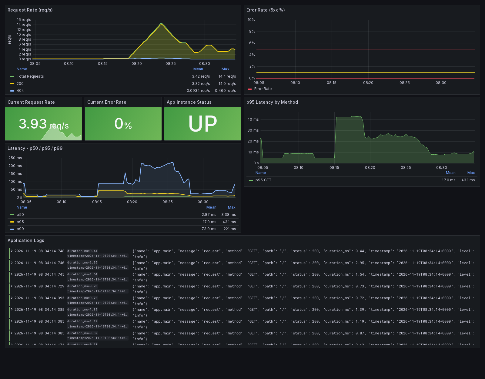
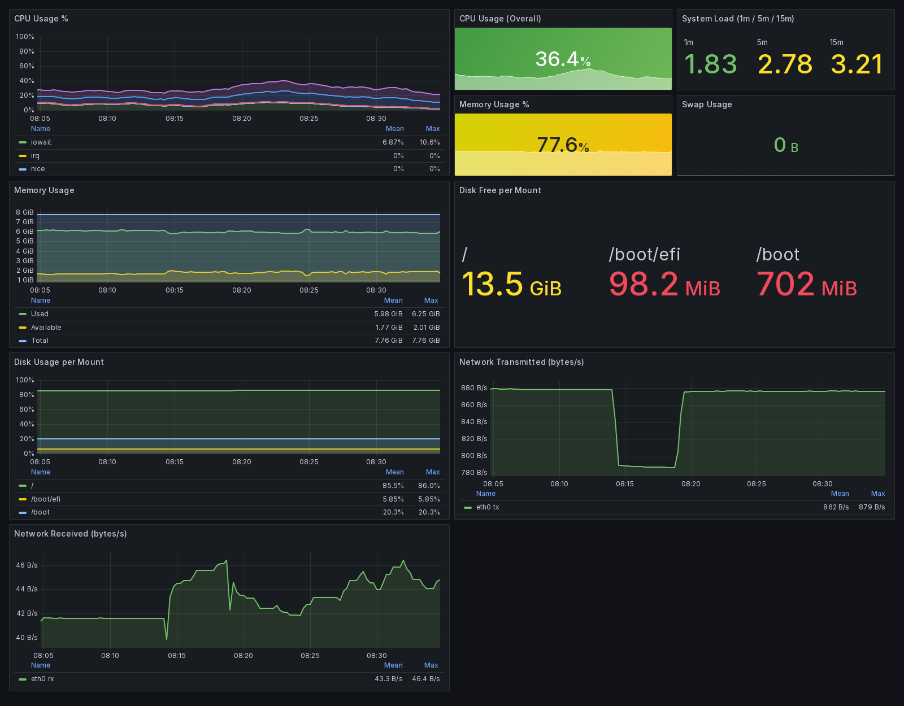
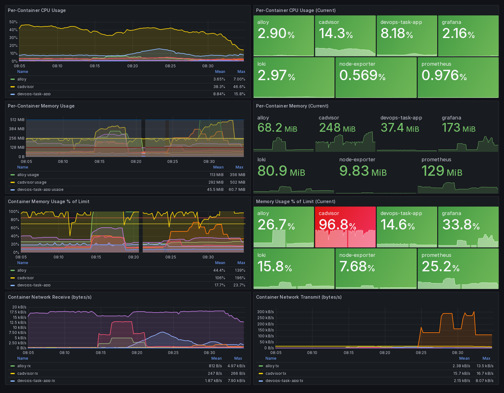
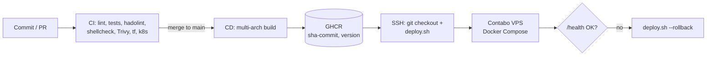
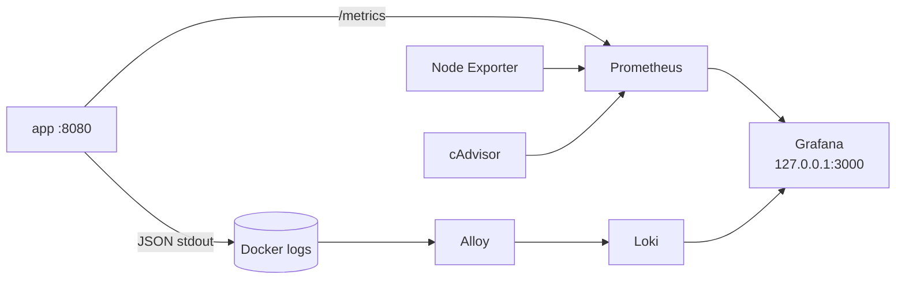
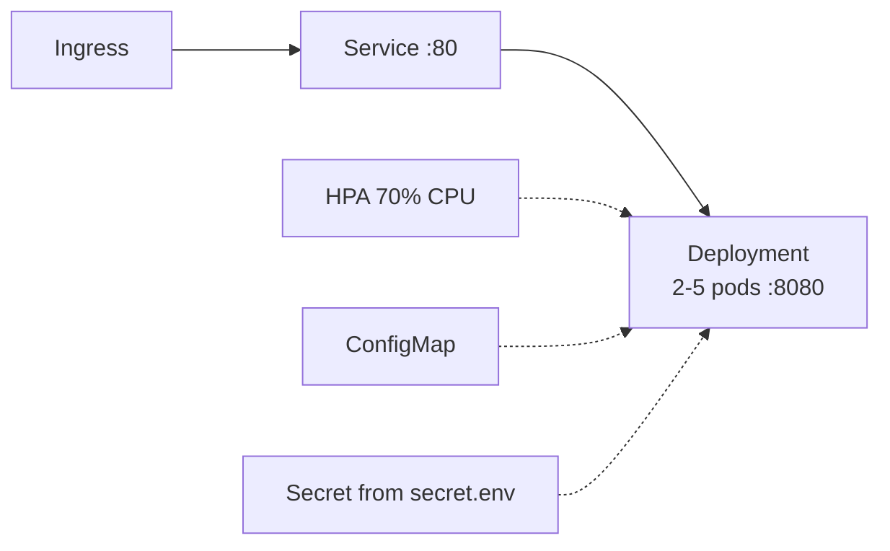

# DevOps Task

A small FastAPI service taken from code to a monitored, automatically deployed setup: Docker, GitHub Actions, Terraform, Kubernetes, Prometheus/Grafana/Loki and a health-check script.

**Deployment target:** a Contabo VPS instead of AWS EC2. I don't have an AWS account, so Step 3 uses the Contabo Terraform provider and CD deploys over SSH. Each AWS requirement has an equivalent, listed in [Infrastructure](#infrastructure-terraform-on-contabo).

| | |
|---|---|
| App | `GET /` info, `GET /health`, `GET /metrics` (request count, errors, latency histogram) |
| Image | `python:3.12.16-slim-trixie`, multi-stage, non-root, **~49 MB compressed / 202 MB unpacked**, 0 fixable CRITICAL CVEs |
| CI | flake8, pytest (94% coverage), hadolint, shellcheck, Trivy, terraform validate, kubeconform |
| CD | multi-arch build → GHCR → SSH deploy → smoke test → automatic rollback |
| Observability | Prometheus, Grafana, Loki, Alloy, Node Exporter, cAdvisor, 4 alerts, 3 dashboards |

## Contents

- [Quick start](#quick-start)
- [CI/CD](#cicd)
- [Infrastructure (Terraform on Contabo)](#infrastructure-terraform-on-contabo)
- [Kubernetes](#kubernetes)
- [Observability](#observability)
- [Health check script](#health-check-script)
- [Architecture](#architecture)
- [Design decisions](#design-decisions)
- [Deployment and rollback](#deployment-and-rollback)
- [Security](#security)
- [Cost estimate](#cost-estimate)
- [Verified on a real server](#verified-on-a-real-server)
- [What I would improve with more time](#what-i-would-improve-with-more-time)
- [AI tools usage](#ai-tools-usage)

## Quick start

Requirements: Docker 24+ with Compose v2. For the rest: Python 3.12, kubectl + kind, Terraform 1.10+, shellcheck.

```bash
cp .env.example .env        # set GF_SECURITY_ADMIN_PASSWORD

docker compose up -d --build                                                  # app only
docker compose -f docker-compose.yml -f docker-compose.monitoring.yml up -d --build   # app + monitoring (or: make up)

curl localhost:8080/            # {"message":"Hello from DevOps Task!","status":"running","version":"1.0.0"}
curl localhost:8080/health
curl localhost:8080/metrics
```

Grafana: http://localhost:3000, user `admin`, password from `.env`. The three dashboards are under **Dashboards**.

Configuration comes from environment variables (`APP_PORT`, `LOG_LEVEL`, `ENVIRONMENT`). Logs are JSON on stdout, and SIGTERM triggers a graceful shutdown.

Tests and lint:

```bash
pip install -r requirements-dev.txt
make test     # 10 tests, 94% coverage
make lint     # flake8 + shellcheck
```

## CI/CD

**Pull requests** (`.github/workflows/ci.yml`): flake8 + pytest with a coverage report, hadolint + shellcheck, image build + Trivy, pinned to a commit (fails on fixable CRITICAL CVEs, HIGH goes to the Security tab), `terraform fmt/validate`, kustomize render + kubeconform.

**Push to `main`** (`.github/workflows/cd.yml`):

1. Build `linux/amd64` and `linux/arm64` with the GitHub Actions layer cache.
2. Push to GHCR as `sha-<commit>` (immutable, this is what gets deployed), `<VERSION>` and `latest`.
3. SSH to the server, check out the same commit, run `scripts/deploy.sh <image>`. It recreates only the app and waits for the Docker health check; if the new container never becomes healthy it puts the previous image back.
4. `curl` the public `/health`. If that fails, run `deploy.sh --rollback`.

Settings (nothing is hardcoded):

| Name | Where | Value |
|---|---|---|
| `DEPLOY_ENABLED` | repository variable | `true` once a server exists. Until then the deploy job is skipped |
| `SSH_PRIVATE_KEY` | `production` environment secret | private key of the `deploy` user |
| `SSH_KNOWN_HOSTS` | `production` environment secret | `ssh-keyscan -t ed25519 <server-ip>`, so the host key is pinned |
| `GHCR_PULL_TOKEN` | `production` environment secret, optional | `read:packages` token if the image is private |
| `SSH_HOST` | `production` environment variable | server IP |
| `HEALTH_CHECK_URL` | `production` environment variable | e.g. `http://<ip>/health` |
| `SSH_USER`, `APP_DIR` | `production` environment variable, optional | default `deploy`, `/opt/devops-task` |

`DEPLOY_ENABLED` has to be a repository variable: environment variables aren't visible to a job-level `if:`.

## Infrastructure (Terraform on Contabo)

| Task requirement (AWS) | Here |
|---|---|
| EC2 in a VPC | `contabo_instance`, Ubuntu 24.04 |
| Security group with only required ports | UFW: SSH (from `allowed_ssh_cidr`) and the app port. Grafana listens on 127.0.0.1 only |
| Least-privilege instance profile, no static keys | No cloud credentials on the server. Non-root `deploy` user, key-only SSH, fail2ban. Image pulls need no token (public package) |
| User data installs Docker and runs the app | `cloud-init.yaml.tftpl`: Docker, firewall, SSH hardening, repo checkout, `.env` with a random Grafana password, monitoring stack, health-check timer. The first CD run starts the app |
| Logs to CloudWatch with retention | Docker logs rotated (10 MB × 3) and shipped by Alloy to Loki, 7-day retention |
| Remote state in S3 with locking | `s3` backend on Contabo Object Storage, `use_lockfile = true` (no DynamoDB) |
| Same code for staging and production | `envs/<env>.tfvars` + `envs/<env>.s3.tfbackend` |

```bash
export TF_VAR_contabo_client_id=... TF_VAR_contabo_client_secret=...
export TF_VAR_contabo_api_user=...  TF_VAR_contabo_api_password=...
export AWS_ACCESS_KEY_ID=... AWS_SECRET_ACCESS_KEY=...     # Object Storage S3 keys

make tf-init tf-plan tf-apply ENV=staging
terraform -chdir=terraform output                           # public_ip, health_url, ssh_command, grafana_tunnel
```

Before applying, check `product_id` and `image_id` in `envs/*.tfvars` (`cntb get images --name ubuntu`) and the storage endpoint in `envs/*.s3.tfbackend`. Things to know about Contabo:

- Changing `user_data` reinstalls the VPS, so cloud-init is bootstrap only and later changes go through CD.
- Instances are billed monthly; `terraform destroy` doesn't refund the current month.
- Locking depends on the object store honouring conditional writes, so I also run Terraform from one place at a time.

On the server everything lives in `/opt/devops-task` (a git checkout). `.env` (chmod 600) holds `APP_IMAGE` and the Grafana password, and `.deploy/` records the current and previous image. Grafana is reached through a tunnel: `ssh -N -L 3000:127.0.0.1:3000 deploy@<ip>`.

## Kubernetes

Manifests in `k8s/` (Kustomize): Deployment with 2 replicas, `maxUnavailable: 0` / `maxSurge: 1`, `/health` probes, requests and limits, a 5s `preStop` sleep, non-root user, read-only root filesystem, all capabilities dropped and `RuntimeDefault` seccomp. Plus a Service, an Ingress (nginx class; port-forward on kind), a ConfigMap, an HPA (2–5 replicas at 70% CPU), and a Secret generated from a git-ignored `k8s/secret.env`.

```bash
kind create cluster --name devops-task

# images aren't on GHCR before CD runs, so build and load them
docker build -t ghcr.io/arifuzzamanjoy/devops-task:1.0.0 .
echo 1.1.0 > VERSION && docker build -t ghcr.io/arifuzzamanjoy/devops-task:1.1.0 . ; git checkout VERSION
kind load docker-image ghcr.io/arifuzzamanjoy/devops-task:1.0.0 ghcr.io/arifuzzamanjoy/devops-task:1.1.0 --name devops-task

# metrics-server so the HPA can read CPU
kubectl apply -f https://github.com/kubernetes-sigs/metrics-server/releases/latest/download/components.yaml
kubectl -n kube-system patch deploy metrics-server --type=json \
  -p='[{"op":"add","path":"/spec/template/spec/containers/0/args/-","value":"--kubelet-insecure-tls"}]'

cp k8s/secret.env.example k8s/secret.env
kubectl apply -k k8s/
kubectl port-forward -n devops-task svc/devops-task 8080:80
```

### Rolling update and rollback (real output)

Recorded on kind (Kubernetes v1.37). A curl pod sent 5 requests per second to the Service for 100 seconds during the update and the rollback:

```bash
kubectl run load -n devops-task --image=curlimages/curl:8.10.1 --restart=Never -- sh -c \
  'ok=0; fail=0; end=$(( $(date +%s) + 100 )); while [ $(date +%s) -lt $end ]; do
     if curl -sf -m 2 http://devops-task/ >/dev/null; then ok=$((ok+1)); else fail=$((fail+1)); fi
     sleep 0.2; done; echo "requests ok=$ok failed=$fail"'
```

```
# traffic checker running: 5 requests/s against the Service during update and rollback

$ kubectl set image deployment/devops-task devops-task=ghcr.io/arifuzzamanjoy/devops-task:1.1.0 -n devops-task
deployment.apps/devops-task image updated

$ kubectl rollout status deployment/devops-task -n devops-task
Waiting for deployment "devops-task" rollout to finish: 1 out of 2 new replicas have been updated...
Waiting for deployment "devops-task" rollout to finish: 1 out of 2 new replicas have been updated...
Waiting for deployment "devops-task" rollout to finish: 1 out of 2 new replicas have been updated...
Waiting for deployment "devops-task" rollout to finish: 1 old replicas are pending termination...
Waiting for deployment "devops-task" rollout to finish: 1 old replicas are pending termination...
Waiting for deployment "devops-task" rollout to finish: 1 old replicas are pending termination...
deployment "devops-task" successfully rolled out

$ kubectl get pods -n devops-task -l app.kubernetes.io/name=devops-task
NAME                           READY   STATUS        RESTARTS   AGE
devops-task-5b87587dff-wtccz   1/1     Terminating   0          28s
devops-task-7d9fbcd7cd-gvrzj   1/1     Running       0          14s
devops-task-7d9fbcd7cd-lz8zf   1/1     Running       0          7s

$ kubectl rollout history deployment/devops-task -n devops-task
deployment.apps/devops-task 
REVISION  CHANGE-CAUSE
2         <none>
3         <none>
4         <none>
5         <none>

$ kubectl rollout undo deployment/devops-task -n devops-task
Warning: resource deployments/devops-task was previously managed with 'kubectl apply'. Rolling back will not update the kubectl.kubernetes.io/last-applied-configuration annotation, which may cause unexpected behavior on future 'kubectl apply' operations. Consider using 'kubectl apply' with your previous configuration file instead.
deployment.apps/devops-task rolled back

$ kubectl rollout status deployment/devops-task -n devops-task
Waiting for deployment "devops-task" rollout to finish: 1 out of 2 new replicas have been updated...
Waiting for deployment "devops-task" rollout to finish: 1 out of 2 new replicas have been updated...
Waiting for deployment "devops-task" rollout to finish: 1 out of 2 new replicas have been updated...
Waiting for deployment "devops-task" rollout to finish: 1 out of 2 new replicas have been updated...
Waiting for deployment "devops-task" rollout to finish: 1 old replicas are pending termination...
Waiting for deployment "devops-task" rollout to finish: 1 old replicas are pending termination...
Waiting for deployment "devops-task" rollout to finish: 1 old replicas are pending termination...
deployment "devops-task" successfully rolled out

$ kubectl get deployment devops-task -n devops-task -o jsonpath='{..image}'
ghcr.io/arifuzzamanjoy/devops-task:1.0.0

$ kubectl logs load -n devops-task
requests ok=462 failed=0

$ kubectl get hpa -n devops-task
NAME          REFERENCE                TARGETS       MINPODS   MAXPODS   REPLICAS   AGE
devops-task   Deployment/devops-task   cpu: 8%/70%   2         5         2          6m12s
```

**0 of 462 requests failed.** The first run without `preStop` lost 3 of 412: Kubernetes sends SIGTERM and removes the pod from the Service at the same moment, so a few requests still reach a pod that is shutting down. Five seconds of `preStop` sleep covers that gap. The `last-applied-configuration` warning is expected after `rollout undo`; in a GitOps setup the rollback would be a revert commit.

### On EKS

- **Ingress:** AWS Load Balancer Controller (ALB) with ACM certificates.
- **Secrets:** External Secrets Operator reading from AWS Secrets Manager.
- **Nodes:** Karpenter for node autoscaling, with the HPA unchanged.
- **IAM:** IRSA or Pod Identity, so pods get scoped AWS permissions.
- **Monitoring:** kube-prometheus-stack, with logs shipped to Loki or CloudWatch.

## Observability

```bash
docker compose -f docker-compose.yml -f docker-compose.monitoring.yml up -d
```

| Component | Image | Notes |
|---|---|---|
| Prometheus | `prom/prometheus:v2.54.1` | scrapes app, node-exporter, cadvisor; 15-day retention |
| Loki | `grafana/loki:3.2.0` | 7-day retention (compactor) |
| Alloy | `grafana/alloy:v1.4.2` | discovers containers through the Docker API, parses the app's JSON logs |
| Grafana | `grafana/grafana:11.2.2` | data sources and dashboards provisioned from `monitoring/grafana/` |
| Node Exporter | `prom/node-exporter:v1.8.2` | host metrics |
| cAdvisor | `ghcr.io/google/cadvisor:v0.57.0` | container metrics (Docker containers only, unused metrics disabled) |

Only Grafana publishes a port, on `127.0.0.1` by default; everything else talks over the internal `monitoring` network. Grafana's admin credentials come from `.env`.

### Dashboards

Screenshots from the Contabo server, with traffic from a load generator.

**Application:** request rate, error rate, p50/p95/p99 latency, and the app's logs in the same view.


**Host:** CPU, memory, disk and network from Node Exporter.


**Containers:** CPU, memory and memory as a percentage of the configured limit, per container.


### Alerts

| Alert | Condition | For | Why |
|---|---|---|---|
| AppInstanceDown | `up{job="app"} == 0` | 1m | Four failed scrapes in a row: long enough to ignore one slow scrape, short enough to page fast |
| HighErrorRate | 5xx above 5% of requests | 5m | 5% is well above normal noise; 5 minutes skips short blips during deploys |
| HostDiskUsageHigh | disk above 80% | 10m | Leaves time to clean up before the disk is full; disk changes slowly, so a long `for` avoids flapping |
| ContainerMemoryNearLimit | working set above 85% of the limit | 5m | Working set is what the OOM killer counts; warns before a kill without firing on short spikes |

### Logs and labels

Every request is logged as one JSON line with `method`, `path`, `status` and `duration_ms`. Loki indexes only `job` (compose service), `container_name` and `level`; everything else is filtered at query time (`{job="app"} | json | status >= 500`). Prometheus works the same way: the `endpoint` label is the route template, and unknown URLs share `unmatched`, so bots probing random paths can't create new series.

### Host access granted

| Mount / privilege | Used by | Why |
|---|---|---|
| `/proc`, `/sys`, `/` (read-only) | Node Exporter | CPU, memory, filesystem and network stats of the host |
| `/`, `/sys`, `/var/run`, `/var/lib/docker` (read-only), `/dev/kmsg` | cAdvisor | cgroup stats and container metadata |
| `privileged: true` | cAdvisor | needed to read cgroups and kernel interfaces |
| `/var/run/docker.sock` (read-only) | Alloy | container discovery and log streaming |

### An error spike appears. How do you find the cause?

1. On the Application dashboard, note when the 5xx rate rose and whether latency moved with it.
2. In the logs panel below, narrow to that window with `{job="app", level="error"} | json`. Each line shows the failing `path`, `status` and `duration_ms`.
3. Rising latency together with errors usually means resource pressure: check the Containers dashboard for memory near its limit or CPU throttling.
4. Check the Host dashboard for a full disk, memory pressure or CPU steal.
5. If nothing stands out, compare the time with the last deploy (CD run, `deploy.sh --status`) and roll back.

## Health check script

`scripts/system_health.sh` collects CPU, memory, disk (all real filesystems), load average and the top 5 processes by memory. It appends each report to a log rotated at 10 MB (5 kept) and exits with `0` healthy, `1` warning or `2` critical. It passes shellcheck with no warnings.

```bash
./scripts/system_health.sh                              # defaults: --disk 80 --cpu 90 --mem 85 --crit 95
./scripts/system_health.sh --disk 90 --json             # one JSON object, with an "alerts" list
./scripts/system_health.sh --log-file /var/log/health_log.txt
```

Runs every 5 minutes with the systemd timer (cloud-init installs it on the server):

```bash
sudo ln -s "$PWD/scripts/system_health.sh" /opt/scripts/system_health.sh
sudo cp scripts/system_health.{service,timer} /etc/systemd/system/
sudo systemctl daemon-reload && sudo systemctl enable --now system_health.timer
```

Or with cron: `*/5 * * * * /opt/scripts/system_health.sh --log-file /var/log/health_log.txt >/dev/null 2>&1`

## Architecture







## Design decisions

- **FastAPI:** small, async, with a mature Prometheus client. Go would give a smaller image, but no part of this task needs it.
- **slim over distroless:** distroless would be about 20 MB smaller but has no shell, which makes debugging harder. Test tools stay out of the image (`requirements-dev.txt`), and `.dockerignore` is an allowlist.
- **GHCR:** works with the built-in `GITHUB_TOKEN`, so CI needs no registry secret. On AWS I would use ECR with a VPC endpoint.
- **A VPS with Compose instead of EC2/ECS/EKS:** one stateless service doesn't need an orchestrator in production. Kubernetes is covered by the kind setup.
- **Tags:** `sha-<commit>` is immutable and is what deploys and rollbacks use; the version tag is for people. Never `latest` alone.
- **Alloy over Promtail:** Promtail is in maintenance mode, and Alloy reads logs through the Docker API without host log mounts.
- **Secrets:** GitHub environment secrets for CD, `TF_VAR_*` for Terraform, a git-ignored `.env` on the server, a git-ignored `secret.env` for Kubernetes.

## Deployment and rollback

1. A PR passes CI and is merged.
2. CD builds and pushes `sha-<commit>`. The `production` environment can require an approval.
3. The server checks out that commit, so compose and monitoring config match the image, and `deploy.sh` swaps only the app container.
4. Rollback is automatic in two places: on the server, if the container doesn't turn healthy within about 60s, and from CI, if the public `/health` fails. Manual rollback: `./scripts/deploy.sh --rollback`, or deploy any older `sha-` tag. On Kubernetes: `kubectl rollout undo`.

The VPS swap restarts the container (a few seconds). Zero downtime there would need two app containers behind a proxy; the Kubernetes setup shows the zero-downtime path.

## Security

| Area | How |
|---|---|
| Secrets | Nothing committed; GitHub environment secrets, `TF_VAR_*`, git-ignored `.env` (chmod 600) and `k8s/secret.env`. Grafana password generated at bootstrap |
| Image | Non-root UID 1001, read-only root filesystem, `no-new-privileges`, Trivy gate in CI |
| Access | No cloud credentials on the server. Key-only SSH, root password login off, fail2ban, unattended upgrades. Membership in the docker group is effectively root, so the deploy key is treated as privileged |
| CD | Host key pinned with `StrictHostKeyChecking yes`; secrets scoped to the `production` environment |
| Network | UFW allows SSH and the app port only. Grafana on 127.0.0.1 (Docker-published ports bypass UFW), everything else on an internal network |

## Cost estimate

| | Contabo (used here) | AWS equivalent |
|---|---|---|
| Compute | Cloud VPS 10, 4 vCPU / 8 GB: ~€5–7 | t3.small: ~$15 + 20 GB gp3: ~$1.60 |
| State | Object Storage: ~€3 | S3 + DynamoDB: <$0.10 |
| Logs | included (Loki on the VPS) | CloudWatch, 5 GB: ~$2.50 |
| Traffic | included | 10 GB out: ~$0.90 |
| **Total** | **~€8–10 / month** | **~$20 / month** |

## Verified on a real server

Everything except `terraform apply` and a live CD deploy was run on a Contabo VPS (Ubuntu 24.04, Docker 29) that also hosts other services, so the app used port 8088 there. Checked: deploy, automatic rollback of a broken image, manual rollback, Prometheus targets, logs in Loki, provisioned dashboards, config reload after `git checkout`, and the health script's exit codes. The whole stack uses about 450 MB of RAM.

That testing caught problems that don't show up locally:

- cAdvisor v0.49 can't talk to Docker 29; pinned v0.57, limited to the metrics in use (33 MB instead of 444 MB).
- Single-file bind mounts kept old configs after `git checkout`; configs are mounted as directories and reloaded on deploy.
- The memory alert divided by zero for containers without a limit, and the error-rate alert compared each 5xx series with itself.
- Alloy re-sent months of old logs after every restart; its positions are now kept in a volume.
- Graceful shutdown was blocked by a custom signal handler; uvicorn now handles SIGTERM.

## What I would improve with more time

- TLS (Caddy) and blue/green app containers for zero-downtime deploys on the VPS
- A WireGuard tunnel or self-hosted runner, so SSH isn't open to all GitHub runner IPs
- Alertmanager routing to Slack, and health-script alerts to a webhook
- Off-host storage for logs and metrics, so they survive losing the VPS
- Helm chart with staging/production values, Cosign signing and an SBOM in CD
- OpenTelemetry traces in Tempo

## AI tools usage

I used AI coding assistants (GitHub Copilot with vs code IDE) to accelerate boilerplate generation — particularly for Grafana dashboard JSON configurations and Terraform resource blocks. All generated code was reviewed, tested, and adapted to meet the specific requirements of this assessment. I can explain every configuration choice, threshold value, and architectural decision in detail during a discussion.
